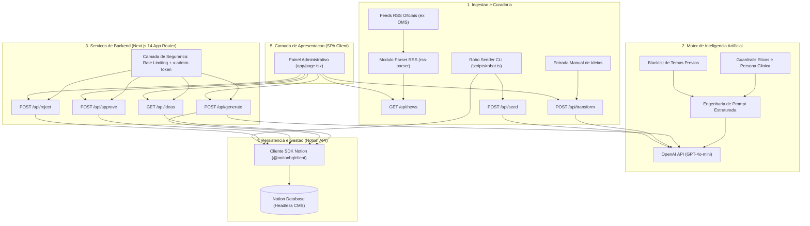

# Plataforma de Gestao Editorial e Automacao de Conteudo em Saude Preventiva Corporativa

Sistema web full-stack desenvolvido em Next.js 14, TypeScript, Notion API e OpenAI para gestao do ciclo de vida, curadoria e geracao assistida de comunicados de saude preventiva no ambiente corporativo, operando sob o modelo Human-in-the-Loop com guardrails eticos estritos.

---

## Visao Geral e Contexto Operacional

A comunicacao em saude preventiva dentro de organizacoes corporativas enfrenta dois obstaculos recorrentes: a dificuldade de manter consistencia editorial sem sobrecarregar profissionais especializados e o risco de disseminacao de informacoes imprecisas ou desconformes com diretrizes eticas da area medica.

Modelos generativos convencionais tendem a produzir textos genericos, desprovidos de embasamento pratico ou, em casos mais graves, que sugerem diagnosticos e tratamentos farmacologicos sem avaliacao clinica previa.

Esta plataforma resolve esse gargalo ao estruturar uma central operacional que combina:

1. Curadoria ativa de fontes publicas: Leitura automatizada de feeds RSS de autoridades globais em saude (como a Organizacao Mundial da Saude - OMS).
2. Geracao assistida orientada por guardrails: Parametrizacao rigida de Large Language Models (LLMs) com foco exclusivo em medicina do trabalho e habitos cotidianos, vedando mencoes a medicamentos, promessas terapeuticas ou linguagem alarmista.
3. Persistencia desacoplada via Headless CMS: Utilizacao da API do Notion como banco de dados flexivel para catalogacao, revisao e controle de status editorial.
4. Human-in-the-Loop mandatario: O fluxo de aprovacao exige validacao manual do especialista antes da disponibilizacao final do texto, garantindo conformidade com a responsabilidade tecnica em saude.

---

## Arquitetura do Sistema

A solucao adota uma arquitetura full-stack coesa suportada pelo Next.js 14 App Router, integrando servicos externos por meio de clientes tipados e rotas de servidor protegidas.



---

## Engenharia de Prompt e Guardrails Eticos

Para assegurar que o conteudo gerado mantenha credibilidade tecnica e seguranca juridico-sanitaria, as chamadas a API da OpenAI foram encapsuladas com diretrizes restritivas.

### Persona e Diretrizes Editoriais

O modelo atua sob a persona de uma enfermeira especialista em saude corporativa, priorizando orientacoes de rotina no ambiente de trabalho. As regras mandatorias incluem:

* Proibicao absoluta de nomes de medicamentos, dosagens ou sugestoes de tratamentos farmacologicos.
* Proibicao de promessas de cura, diagnósticos remotos ou sensacionalismo.
* Foco restrito a ergonomia, hidratacao, pausas ativas, qualidade do sono e higiene mental.
* Inclusao obrigatoria de recomendacao de consulta com profissional de saude habilitado em caso de persistencia de sintomas.
* Prevencao de redundancia tematica por meio da extracao dinamica dos ultimos topicos ja aprovados no banco de dados.

### Estrutura Padronizada de Conteudo

Todo texto gerado deve obedecer a uma divisao estrita em cinco blocos textuais:

1. Gancho contextual: Situacao rotineira comum ao trabalhador, sem relato pessoal ficticio.
2. Explicacao simplificada: Mecanismo basico da influencia do habito no bem-estar, em termos acessiveis.
3. Diretrizes praticas: Lista concisa de acoes imediatas utilizando marcadores de topico uniformes.
4. Observacao de responsabilidade: Orientacao etica instruindo a busca por auxilio medico especializado.
5. Fechamento: Conclusao sintetica estimulando a consistencia de habitos.

---

## Modelagem de Dados no Notion

O sistema utiliza um banco de dados relacional no Notion como camada de persistencia e CMS. A integracao via SDK `@notionhq/client` requer as seguintes propriedades configuradas na tabela:

| Propriedade | Tipo no Notion | Finalidade Operacional |
| :--- | :--- | :--- |
| `Tema` | Title | Titulo ou foco central do comunicado de saude |
| `Subtema` | Rich Text | Especificacao do contexto ou recorte da abordagem |
| `Status` | Select | Estado no pipeline: `Ideia`, `Gerado`, `Aprovado`, `Postado` |
| `Tipo` | Select | Categoria da pauta: `Base`, `Atualidade`, `Pilar Basico` |
| `Texto` | Rich Text | Conteudo integral formatado do post |
| `Data Postagem`| Date | Data planejada ou realizada de publicacao externa |
| `Tags` | Multi-select | Classificacao tematica (ex: Sono, Ergonomia, Nutricao) |
| `Created` | Created time | Carimbo temporal utilizado para ordenacao descendente |

---

## Camada de Seguranca e Resiliencia

Como a plataforma interage diretamente com APIs que geram custos financeiros por requisicao (OpenAI e Notion), foram implementados mecanismos de defesa em profundidade:

1. Autenticacao Administrativa: Rotas criticas validam o cabecalho HTTP `x-admin-token` contra o segredo definido em variavel de ambiente. Em ambiente de desenvolvimento local, o bloqueio permanece permissivo para facilitar testes, ativando-se automaticamente em modo de producao.
2. Rate Limiting em Memoria: Implementacao do algoritmo de balde de taxas (Token Bucket) indexado pelo endereco IP real do cliente (obtido via headers `x-forwarded-for` ou `x-real-ip`). O mecanismo impede loops de requisicao e ataques de negacao de servico.
3. Exclusao Logica (Soft Delete): Ao reprovar uma pauta, o registro correspondente no Notion e arquivado (`archived: true`), preservando historico sem poluir a listagem operacional da interface.

---

## Automacao de Povoamento (Robo Seeder)

O projeto inclui um script autonomo de geracao em lote em [scripts/robot.ts](file:///c:/Users/eduar/remake/appsaude/scripts/robot.ts), projetado para criar lotes de conteudo pre-formatado reduzindo a dependencia de intervencao manual constante.

Fluxo do script:
1. Conecta-se a base do Notion e recupera todos os titulos e subtemas ja cadastrados.
2. Formula uma lista de exclusao semantica para garantir diversidade editorial.
3. Dispara requisicao a OpenAI utilizando o recurso de Structured Outputs (`response_format: { type: "json_schema" }`) para garantir conformidade do payload JSON.
4. Valida programmaticamente se o texto retornado contem exatamente 5 paragrafos e inclui marcadores de topico.
5. Insere os registros aprovados diretamente no Notion com intervalo controlado de 1 segundo entre requisicoes, prevenindo limites de taxa (rate limits) da API externa.

Para executar o robô:
```bash
npm run seed
```

---

## Endpoints da API

Todas as rotas estao localizadas sob o diretorio `app/api/`:

| Rota | Metodo | Parametros | Descricao |
| :--- | :--- | :--- | :--- |
| `/api/ideas` | GET | Nenhum | Lista ate 50 ideias com status `Ideia`, `Gerado` ou `Aprovado` |
| `/api/ideas/create` | POST | `{ theme: string, text: string }` | Cria nova pauta gerada manualmente diretamente no Notion |
| `/api/generate` | POST | `{ pageId: string }` | Gera o texto completo via LLM para uma ideia pendente e atualiza o Notion |
| `/api/approve` | POST | `{ pageId: string }` | Transita o status da pauta para `Aprovado` |
| `/api/reject` | POST | `{ pageId: string }` | Arquiva a pagina no Notion (soft delete) |
| `/api/transform` | POST | `{ input: string }` | Converte um rascunho livre em um post estruturado de 5 blocos |
| `/api/news` | GET | Nenhum | Recupera noticias recentes de feeds RSS oficiais para pautas de atualidade |
| `/api/seed` | POST | Nenhum | Dispara o processo do robo gerador via endpoint HTTP |

---

## Tecnologias Utilizadas

* [Next.js](https://nextjs.org/) 14.2 (App Router, Server-side Rendering e API Routes)
* [React](https://react.dev/) 18.3
* [TypeScript](https://www.typescriptlang.org/) 5.5
* [OpenAI Node SDK](https://github.com/openai/openai-node) (Modelos GPT-4o-mini e GPT-4.1-mini)
* [Notion Client SDK](https://github.com/makenotion/notion-sdk-js) (`@notionhq/client`)
* [RSS Parser](https://github.com/rbren/rss-parser)
* [PostCSS](https://postcss.org/) e CSS Custom Properties para estilizacao modular

---

## Configuracao do Ambiente e Execucao

### 1. Pre-requisitos

* Node.js versao 18.18 ou superior
* Gerenciador de pacotes npm
* Chave de integracao interna da API do Notion com permissao de leitura e escrita na tabela alvo
* Chave de acesso a API da OpenAI com credito disponivel

### 2. Variaveis de Ambiente

Crie um arquivo `.env` na raiz do projeto com base nas variaveis descritas:

```env
NOTION_API_KEY=ntn_sua_chave_de_integracao_notion
NOTION_DATABASE_ID=seu_database_id_do_notion
OPENAI_API_KEY=sk-sua_chave_da_openai
ADMIN_TOKEN=chave_secreta_para_protecao_das_rotas_em_producao
```

### 3. Instalacao das Dependencias

```bash
npm install
```

### 4. Execucao em Modo de Desenvolvimento

```bash
npm run dev
```

A aplicacao estara disponivel em `http://localhost:3000`.

### 5. Compilacao de Producao

```bash
npm run build
npm run start
```

---

## Boas Praticas de Governanca Editorial

A publicacao definitiva dos posts em redes sociais corporativas ou comunicadores internos (como LinkedIn, Slack ou newsletters institucionais) permanece intencionalmente manual. 

Essa decisao de design assegura que qualquer alteracao sutil em politicas de saude, recomendacoes vigentes ou tom de voz da marca passe pelo crivo analitico de um profissional humano antes de sua veiculacao publica.
